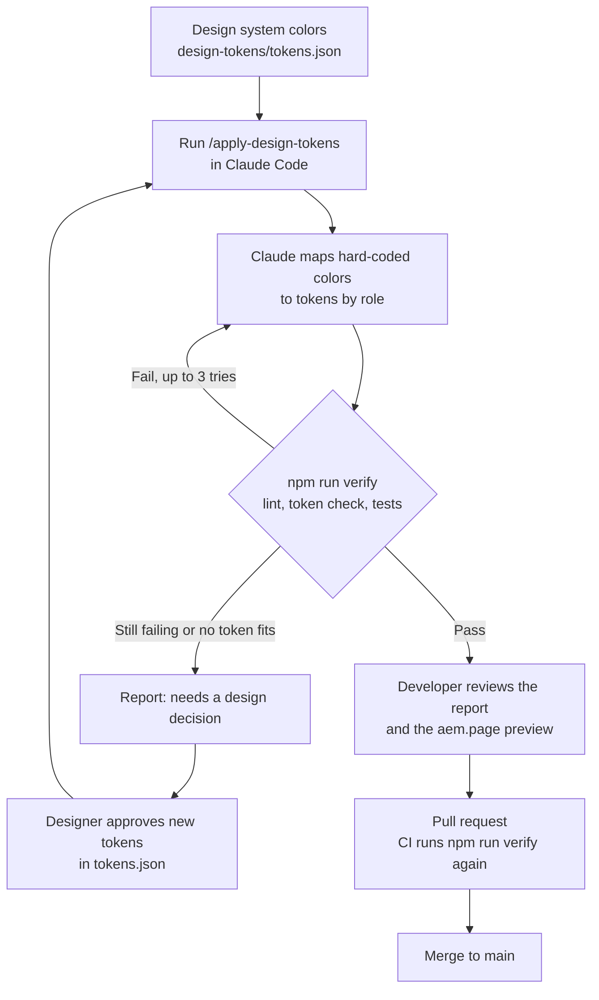

# Design token guardrails for Edge Delivery Services

Keep an AEM Edge Delivery Services site on its design system, even when Claude Code writes the CSS.

*An AI recipe for the [Adobe Experience League AI Recipe Library](https://experienceleaguecommunities.adobe.com/p/ai-recipe-library). Built on [aem-boilerplate](https://github.com/adobe/aem-boilerplate).*

- **`design-tokens/tokens.json`** is the single source of truth (W3C DTCG format: colors, spacing, radius).
- **A generator** writes the tokens into `styles/styles.css` as CSS variables.
- **Quality gates** fail the build when anyone (person or AI) hard-codes a color, invents a variable, hand-edits generated CSS, silences the linter, or picks colors that fail WCAG contrast.
- **A Claude Code skill** (`.claude/skills/apply-design-tokens`) does the judgement work: it maps existing values to the right token and reports what it couldn't map.

The AI does the mapping. The scripts decide whether it's right.

## The workflow



(Also available as an image: [design-tokens/workflow.png](design-tokens/workflow.png).)

## See it in action

This repo contains a real sample run on the boilerplate, plus a custom dark neon "terminal" hero variant (`blocks/hero/hero.css`):

- **Before:** tag [`sample-run-before`](https://github.com/gdboss/ai-recipe-axl-community/tree/sample-run-before). `npm run verify` fails with 13 hard-coded colors.
- **What the skill changed:** [before → after diff](https://github.com/gdboss/ai-recipe-axl-community/compare/sample-run-before...sample-run-after) (3 CSS files, 15 lines).
- **The report:** [design-tokens/SAMPLE-RUN.md](design-tokens/SAMPLE-RUN.md). It covers every mapping, the "needs a design decision" step for the neon colors, and the zero-visual-change check.

## Quick start

```bash
npm install
npm run verify
```

To try the skill yourself, check out the `sample-run-before` tag, open Claude Code in the repo, and run `/apply-design-tokens`.

## Commands

| Command | What it does |
|---|---|
| `npm run tokens:build` | Regenerates the token block in `styles/styles.css` |
| `npm run tokens:check` | Fails if `styles.css` is out of date with `tokens.json` |
| `npm test` | Unit tests + repo gates (contrast, undefined variables, lint disables) |
| `npm run verify` | Everything: ESLint, Stylelint, `tokens:check`, tests. Runs in GitHub Actions on every push. |

Requires Node 22+. No runtime dependencies: nothing here ships to the browser, and `tools/` and `design-tokens/` are in `.hlxignore`.

## The gates

| Gate | Catches | Where |
|---|---|---|
| Stylelint `color-no-hex`, `color-named`, `function-disallowed-list` | `#dadada`, `red`, `rgb()`, `hsl()`, `oklch()` … in `blocks/` and `styles/` | `.stylelintrc.json` |
| Generated region check | Hand edits to the token CSS, or `tokens.json` changed without a rebuild | `npm run tokens:check` |
| Undefined variables | `var(--color-brand-accent)` when no such token exists (a common AI hallucination) | `test/design-tokens/repo.test.mjs` |
| No color-rule disables | `/* stylelint-disable color-no-hex */` outside the generated block | same |
| WCAG contrast | Token pairs in `contrast-pairs.json` below their minimum ratio | same |
| Token file validation | Bad names, broken or looping aliases, non-hex colors, unitless sizes | `tools/design-tokens/lib.mjs` (unit tested) |

## Prove the gates work

Run each line, check `npm run verify` fails, then `git checkout -- .` to undo.

```bash
# 1. Silence the linter
sed -i 's|solid var(--color-border-subtle);|solid #dadada; /* stylelint-disable-line color-no-hex */|' blocks/cards/cards.css
# 2. Invent a token
sed -i 's|var(--color-border-subtle)|var(--color-border-strong)|' blocks/cards/cards.css
# 3. Hand-edit generated CSS
sed -i 's|--color-brand-500: #3b63fb;|--color-brand-500: #2f5bd3;|' styles/styles.css
# 4. Unreadable text color (then run npm run tokens:build)
sed -i 's|"#505050"|"#9aa0aa"|' design-tokens/tokens.json
# 5. Color in another format
sed -i 's|var(--color-border-subtle)|hsl(0deg 0% 85%)|' blocks/cards/cards.css
```

(On macOS use `sed -i ''`.)

## Add it to your own EDS repo

1. Copy `design-tokens/`, `tools/design-tokens/`, `test/design-tokens/` and `.claude/skills/apply-design-tokens/`.
2. Merge the `scripts` from `package.json`, the rules in `.stylelintrc.json`, the overrides in `.eslintrc.js` and the last two lines of `.hlxignore` from this repo. Optionally change `npm run lint` to `npm run verify` in `.github/workflows/main.yaml`.
3. Add the two marker comments at the top of `:root` in `styles/styles.css`:
   ```css
   /* design-tokens:start - generated by `npm run tokens:build`, do not edit by hand */
   /* design-tokens:end */
   ```
4. Replace `tokens.json` and `contrast-pairs.json` with your design system's values. Start with your site's current colors, so the first run changes nothing visually.
5. Run `npm install && npm run verify` to see the baseline, then in Claude Code: `/apply-design-tokens`.

## Known limits

- Colors are enforced. Spacing and radius tokens are generated but not yet enforced, because block CSS legitimately uses px for borders and breakpoints. Tighten one category at a time.
- Contrast is checked for token pairs, not for text over images or tints (e.g. the hero). Check those by eye.
- Changing token values changes how the site looks. The gates prove consistency, not that it looks right. Always review the preview link.

## License

Apache License 2.0, same as the AEM boilerplate this is based on. The neon hero variant's colors are based on a Figma starter template.
